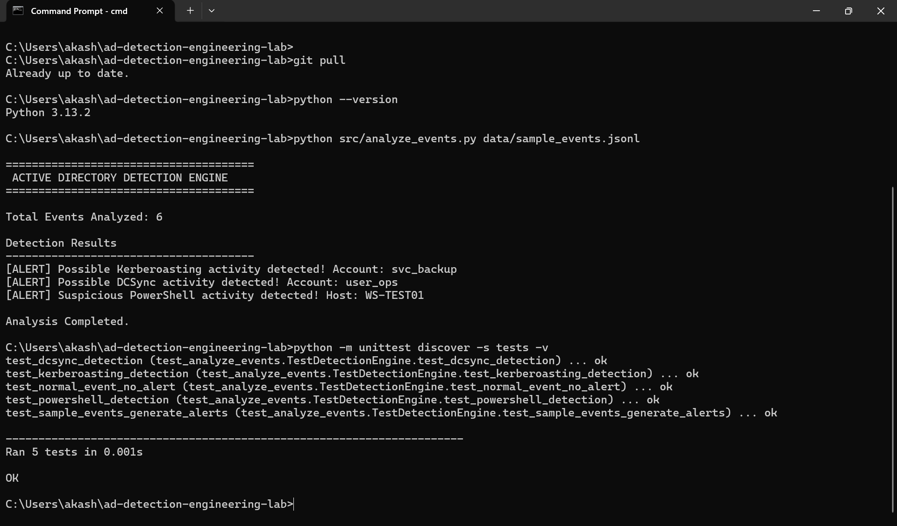

# 🛡️ Active Directory Detection Engineering

### Enterprise Active Directory Attack Simulation, Threat Detection & Incident Response


A hands-on cybersecurity project focused on identifying, detecting, investigating, and responding to suspicious activities within a Microsoft Active Directory environment.

This project explores common enterprise identity attacks and demonstrates how defenders can use Windows security logs, detection engineering, Python, Sigma rules, and SIEM concepts to identify potential threats.

---

## 📑 Table of Contents

- Project Overview
- Objectives
- Technologies & Tools
- Lab Architecture
- Attack Scenarios
- Detection Engineering
- MITRE ATT&CK Mapping
- Investigation & Response
- Project Structure
- Installation
- Execution
- Screenshots & Evidence
- Learning Outcomes
- Future Improvements
- Author
- License

---

## 🎯 Project Overview

Active Directory is widely used in enterprise environments to manage users, computers, authentication, and access permissions.

Attackers who compromise an Active Directory environment may attempt to steal credentials, abuse privileges, move laterally, and access sensitive domain information.

This project focuses on the defensive side of Active Directory security.

The objective is to understand how suspicious activities generate security events and how detection mechanisms can identify potentially malicious behavior.

The project follows a Blue Team security workflow:

**Attack Simulation → Log Collection → Threat Detection → Alert Investigation → Incident Response**

---

## 🎯 Project Objectives

- Understand Active Directory security architecture.
- Explore common enterprise identity attacks.
- Identify suspicious Windows security events.
- Develop detection rules using Sigma.
- Build Python-based event analysis capabilities.
- Map detections to MITRE ATT&CK.
- Investigate suspicious authentication and process activity.
- Understand SOC analyst investigation workflows.

---

## 🧰 Technologies & Tools

| Technology | Purpose |
|---|---|
| Windows Server | Active Directory environment |
| Windows 10/11 | Endpoint testing |
| Active Directory | Identity and access management |
| PowerShell | Windows administration and telemetry |
| Sysmon | Endpoint activity monitoring |
| Windows Event Viewer | Security event investigation |
| Python | Event analysis and detection logic |
| Sigma | Detection rule development |
| Splunk / SIEM concepts | Security monitoring and analysis |
| MITRE ATT&CK | Threat behavior classification |
| VirtualBox / VMware | Isolated virtual lab |

*The table describes the intended lab technology stack. Only tools actually installed and tested should be reported as implemented.*

---

## 🏗️ Lab Architecture

The intended environment consists of a Windows Server domain controller and Windows client machines connected through an isolated virtual network.

```text
             ACTIVE DIRECTORY LAB
                      |
          +-----------+-----------+
          |                       |
     Windows Server          Windows Client
     Domain Controller       Endpoint
          |                       |
          +-----------+-----------+
                      |
               Security Events
                      |
          +-----------+-----------+
          |                       |
      Windows Logs              Sysmon
          |                       |
          +-----------+-----------+
                      |
               Log Collection
                      |
               Detection Engine
                      |
             +--------+--------+
             |                 |
          Sigma Rules       Python
             |                 |
             +--------+--------+
                      |
               Security Alerts
                      |
                Investigation
                      |
                Incident Response
```

---

## 🚨 Attack Scenarios

The project focuses on four important enterprise security scenarios.

### 1. Kerberoasting

**MITRE ATT&CK: T1558.003**

Kerberoasting is an Active Directory attack technique involving the extraction of Kerberos service tickets for offline password-cracking attempts.

Detection focus:
- Unusual Kerberos service-ticket requests.
- Suspicious service account activity.
- Unusual ticket-request patterns.
- Windows Security Event ID 4769.

### 2. DCSync Attack

**MITRE ATT&CK: T1003.006**

DCSync abuses directory replication permissions to request sensitive credential information from a domain controller.

Detection focus:
- Suspicious directory replication activity.
- Unexpected accounts requesting replication.
- Abnormal directory access permissions.
- Windows Security Event ID 4662.

### 3. Suspicious PowerShell Activity

**MITRE ATT&CK: T1059.001**

PowerShell can be abused by attackers to execute commands, download files, and perform malicious administrative activities.

Detection focus:
- Encoded PowerShell commands.
- Suspicious command-line arguments.
- Unusual parent-child process relationships.
- Sysmon Event ID 1.
- PowerShell Event ID 4104.

### 4. Lateral Movement

**MITRE ATT&CK: T1021**

Lateral movement involves accessing additional systems within an environment after obtaining an initial foothold.

Detection focus:
- Unexpected remote logons.
- Suspicious service creation.
- Unusual administrative account usage.
- Windows Security Event ID 4624.
- System Event ID 7045.

---

## 🔍 Detection Engineering

The project uses detection logic to identify suspicious activity from Windows telemetry.

Detection engineering involves:

1. Understanding the attack behavior.
2. Identifying relevant security events.
3. Developing detection logic.
4. Testing against representative events.
5. Investigating potential false positives.
6. Improving detection accuracy.

### Detection Technologies

**Sigma Rules**

Portable detection rules designed to describe suspicious activity across supported SIEM platforms.

**Python Detection Engine**

A Python-based utility for parsing event data and identifying selected suspicious patterns.

**Windows Event Logs**

Security and system events provide important information about authentication, directory access, and system activity.

---

## 🧭 MITRE ATT&CK Mapping

| Attack Technique | Technique ID | Detection Source |
|---|---|---|
| Kerberoasting | T1558.003 | Event ID 4769 |
| DCSync | T1003.006 | Event ID 4662 |
| PowerShell | T1059.001 | Sysmon / PowerShell logs |
| Remote Services | T1021 | Windows logon and service events |

---

## 🕵️ Investigation & Incident Response

When a detection generates an alert, the investigation process includes:

1. Identify the affected account.
2. Identify the affected endpoint.
3. Review timestamps and event details.
4. Correlate related security events.
5. Determine whether the behavior is legitimate or suspicious.
6. Identify potential impact.
7. Document investigation findings.
8. Recommend appropriate containment and remediation.

---

## 📂 Project Structure

```text
ad-detection-engineering-lab/
│
├── README.md
├── LICENSE
├── .gitignore
│
├── screenshots/
│
├── detections/
│   ├── README.md
│   └── sigma/
│       ├── kerberoasting.yml
│       ├── dcsync.yml
│       └── suspicious-powershell.yml
│
├── data/
│   └── sample_events.jsonl
│
├── src/
│   └── analyze_events.py
│
├── docs/
│   ├── architecture.md
│   ├── detection-matrix.md
│   └── investigation-playbook.md
│
└── tests/
    └── test_analyze_events.py
```

---

## ⚙️ Installation

### Requirements

- Python 3.10+
- Git
- Windows environment for collecting Windows telemetry
- Optional isolated virtual machines for Active Directory testing

### Clone Repository

```bash
git clone https://github.com/akashreddygaddam/ad-detection-engineering-lab.git
```

```bash
cd ad-detection-engineering-lab
```

### Install Dependencies

```bash
pip install -r requirements.txt
```

---

## ▶️ Execution

Run the Python event analyzer:

```bash
python src/analyze_events.py data/sample_events.jsonl
```

Run automated tests:

```bash
python -m unittest discover -s tests -v
```

*The included sample data and output must be clearly identified as synthetic unless replaced with actual lab-generated telemetry.*

---

## 📸 Screenshots & Evidence

### Python Detection Engine Execution

The Python detection engine successfully analyzed six synthetic Windows security events and generated three illustrative security alerts.

The detected scenarios include:

- Kerberoasting activity
- DCSync activity
- Suspicious PowerShell execution



### Sigma Detection Rule Validation

All three Sigma detection rules were successfully checked using Sigma CLI 4.0.1.

Validation results:
- Kerberoasting: Passed
- DCSync: Passed
- Suspicious PowerShell: Passed

No rule errors, condition errors, or validation issues were reported.


### Automated Testing Results

The detection engine was tested using Python's built-in unittest framework.

- Total automated tests: 5
- Passed: 5
- Failed: 0

All five tests completed successfully.

Planned evidence:

- Active Directory lab configuration.
- Windows Security Event Viewer.
- Sysmon event collection.
- Sigma detection rules.
- Python detection engine execution.
- Detection and investigation results.

Screenshots will be added after the corresponding activities are performed.

---

## 📚 Learning Outcomes

Through this project, the following cybersecurity concepts are explored:

- Active Directory security.
- Windows event monitoring.
- Enterprise identity attacks.
- Threat detection engineering.
- Sigma detection rules.
- Python security automation.
- MITRE ATT&CK framework.
- SOC alert investigation.
- Incident response fundamentals.

---

## 🚀 Future Improvements

- Integrate Splunk or another SIEM platform.
- Add additional Active Directory attack detections.
- Improve Python detection capabilities.
- Implement automated alert generation.
- Add Windows Event Forwarding.
- Develop detection dashboards.
- Validate rules against real lab-generated telemetry.
- Document false-positive testing and detection tuning.

---

## 👨‍💻 Author

**Akash Reddy**

GitHub: [@akashreddygaddam](https://github.com/akashreddygaddam)

Project: Active Directory Detection Engineering Lab

This repository is maintained as an independent cybersecurity learning and portfolio project.

---

## 📄 License

This project is licensed under the MIT License.
